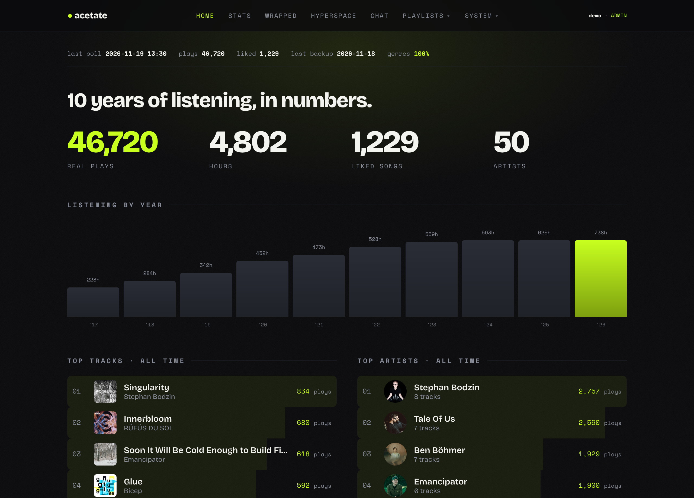
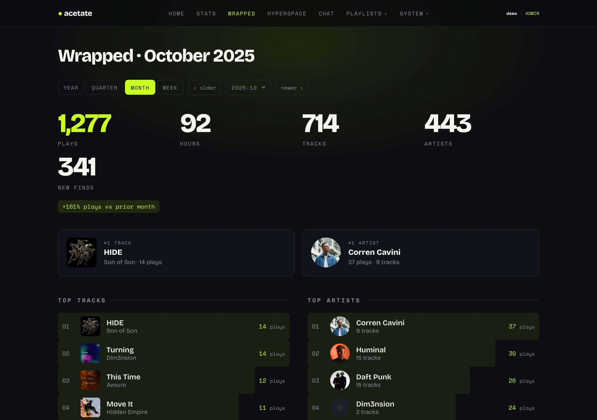
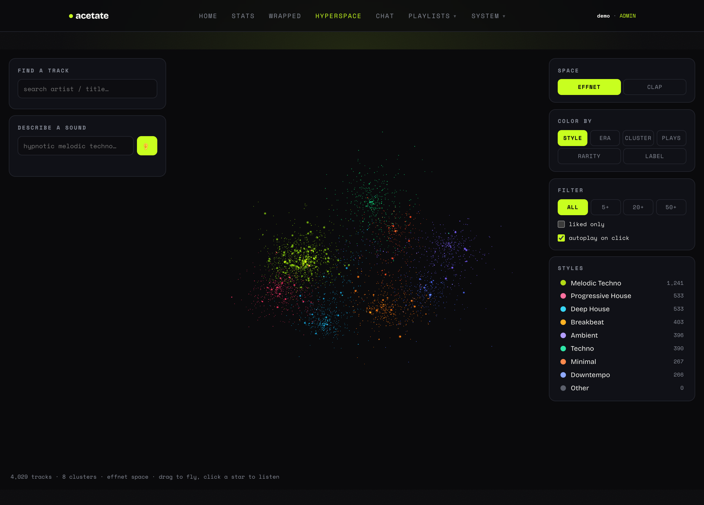
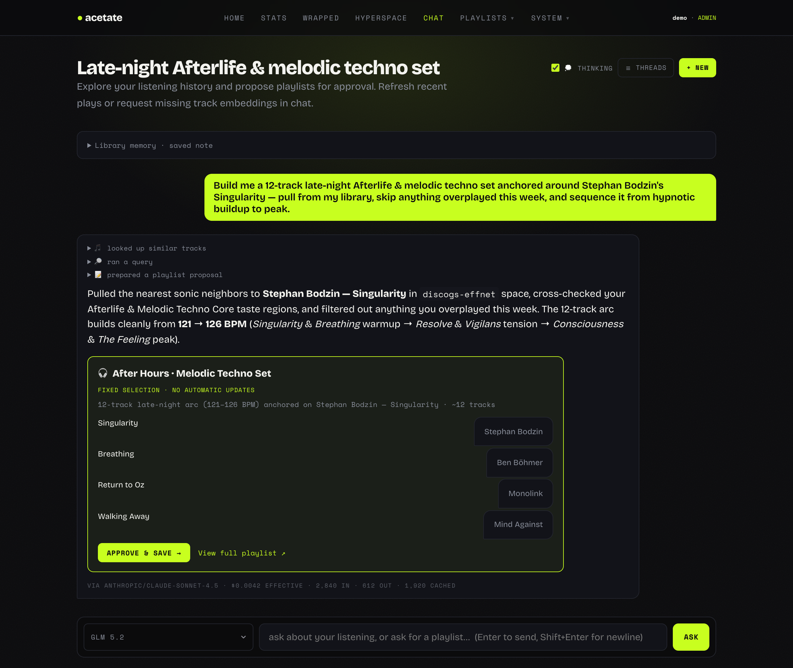
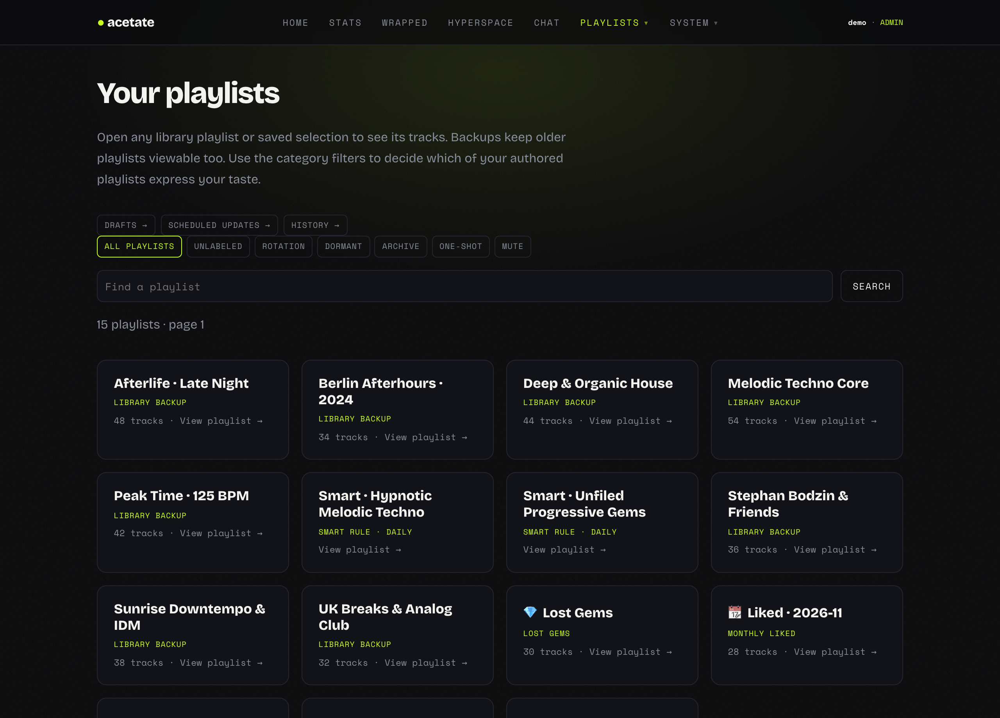

# 🎧 acetate

**Your personal Spotify listening archive — backed up, embedded in 3D audio space, and turned back into playlists.**

[](https://github.com/charlesbine/acetate/actions/workflows/ci.yml)
[](pyproject.toml)
[](LICENSE)

> *An **acetate** is the one-off reference disc a record is cut to before it's mass-pressed: a personal pressing taken straight from the master. This is that, for your listening — a self-hosted archive of everything you play and love.*



---

## Why Acetate?

Streaming services treat your listening history as ephemeral — deleted playlists vanish, Wrapped arrives once a year, and post-2024 Spotify API changes closed off `/v1/audio-features`, artist genres, and public multi-user apps.

Acetate takes the opposite approach: **bring your own Spotify developer app** and keep everything in a single self-hosted SQLite database you own forever.

- **Append-only library backups** — playlists (with full tracklists) and liked songs are snapshotted store-on-change, so even a deleted or overwritten playlist leaves a permanent trace.
- **Complete play history** — import Spotify's multi-year GDPR *"Extended Streaming History"* and run a 15-minute recently-played poller so you never drop a play.
- **Neural audio understanding** — instead of relying on deprecated API features, Acetate fetches 30-second previews and runs open audio models locally (`discogs-effnet`, `genre_discogs400`, `LAION-CLAP`) to map your library by how it actually *sounds*.
- **Strict safety gate** — every automated playlist write funnels through `_assert_managed`: Acetate can only modify playlists it created. User-authored playlists are never overwritten or deleted (the Filing Inbox supports explicit, user-triggered append-only adds with exact ledgered undo).

---

## Visual Tour

### Year-Round Wrapped

Drill into any **year, quarter, month, or week** with period-over-period deltas, `#1` track and artist spotlights, top genres, first-time discoveries (*new to you*), diurnal listening clock, and busiest day.



### Hyperspace — 3D Audio Embedding Map

Your entire library projected into a 3D Three.js point cloud (`UMAP` + `HDBSCAN`) from `discogs-effnet` and `LAION-CLAP` embeddings. Color by Discogs style, era, cluster, play count, rarity, or record label; click any star to hear its preview; or describe a sound in plain English (*"hypnotic melodic techno"*) and watch the matches light up.



### Chat With Your Library

An OpenRouter-backed streaming agent equipped with read-only SQL (`mode=ro` + single-`SELECT` guard), DuckDB statistical analysis, sonic & collaborative similarity, CLAP sound search, and human-in-the-loop **playlist proposals**. Approve a proposal in place to save it as a fixed Curated Playlist or an auto-refreshing Smart Playlist. Shared **Library Memory** keeps naming conventions and curation preferences across threads, while rolling model-aware context compaction keeps long sessions fast.



### Playlists, Smart Rules, Health & Filing

Browse every backed-up, authored, Smart, Curated, and Acetate-managed playlist in one searchable catalog with full tracklists and snapshot diffs. Acetate also turns your authored playlists into embedding-space **taste regions** powering:

- **Playlist Health** (`/health`) — sonic cohesion, style entropy, co-listen density, misfit detection, gap-fill suggestions, and split checks.
- **Filing Inbox** (`/filing`) — liked songs that never landed in a playlist, paired with their top-3 best-fit playlists and one-click append + undo.
- **Unified Review Queue** (`/review`) — accept or reject curation, discovery, and genre suggestions with inline audio previews.
- **Automated Collections** — 📆 `Liked · YYYY-MM` / `YYYY`, 🔥 `Top Played · YYYY-MM`, 💎 `Lost Gems`, 🔁 `On Loop`, 🔭 `Discovery`, and 🧠 `Smart Playlists`.



---

## Architecture

Everything lives in one SQLite database (`data/acetate.db`) with WAL mode and materialized rollups (`recording_stats`) so dashboard reads stay instant even across hundreds of thousands of plays.

```text
Spotify Web API + GDPR Export ──► acetate (CLI + APScheduler)
                                        │
                                        ▼
                               data/acetate.db  (single source of truth)
                                  ▲           │
        Isolated PEP-723 ML envs  │           ▼
        (or Docker embed sidecar) │    FastAPI + HTMX Web App (:8770 / :8765)
        • Deezer/iTunes previews  │    • Home / Stats / Wrapped / Gems
        • discogs-effnet (1280-d) │    • Hyperspace (Three.js 3D)
        • genre_discogs400 (400)  │    • Playlists / Smart / Curated / Health / Filing
        • LAION-CLAP (512-d text) │    • Chat Agent (read-only SQL + proposals)
        • UMAP 3D + HDBSCAN       │    • Optional Authelia forward-auth proxy
```

### Data Layers

| Tier | Source | What It Provides |
|---|---|---|
| **Your Archive** | GDPR export + 15-min poller | Every play with timestamp, listened duration, and context |
| **Your Archive** | Spotify library pulls | Tracks, liked songs, playlists, ISRCs, and append-only snapshots |
| **Audio Layer** | Deezer / iTunes 30s previews | Cached preview audio for embeddings and click-to-play |
| **Audio Layer** | `discogs-effnet` + `discogs400` | 1280-d sonic embedding + top-8 Discogs style scores per track |
| **Audio Layer** | `LAION-CLAP` (music checkpoint) | 512-d joint audio↔text space for free-text sound search |
| **Graph & Meta** | Last.fm + Deezer + MusicBrainz | Co-listening similarity, crowd tags, BPM, record labels, MBIDs |
| **Optional Catalogs** | Local Parquet / `LAION-DISCO-12M` | Optional user-supplied metadata or audio-feature archives (`scripts/import_features.py --parquet ...`) |

> **Model Weight Licensing Note:** Acetate's source code is MIT-licensed. Heavy ML dependencies run in isolated PEP-723 script environments (`scripts/`) and download model weights on demand into `data/models/`. Note that Essentia/MTG pretrained weights (`discogs-effnet` and `genre_discogs400`) are licensed **CC BY-NC-ND 4.0** (personal / non-commercial use only). This repository ships code only — no model weights or personal datasets are redistributed.

---

## Setup Guide

### 1. Prerequisites

- **Python 3.12+** and [`uv`](https://docs.astral.sh/uv/)
- A **Spotify account** (to register your own personal Spotify Developer app)
- Optional: a free [Last.fm API key](https://www.last.fm/api/account/create) (genre tags & co-listening similarity) and an [OpenRouter API key](https://openrouter.ai/) (Chat agent)

### 2. Register Your Spotify Developer App

1. Open the [Spotify Developer Dashboard](https://developer.spotify.com/dashboard) and click **Create app**.
2. Set the **Redirect URI** to the exact loopback address:
   ```text
   http://127.0.0.1:8080/callback
   ```
3. Enable the **Web API** checkbox and save.
4. Copy your **Client ID** and **Client Secret** from the app's **Settings** page.

Acetate requests the following OAuth scopes during `acetate auth`:

- **Read:** `user-read-private`, `user-library-read`, `user-read-recently-played`, `user-read-currently-playing`, `user-top-read`, `playlist-read-private`
- **Write (managed playlists & Filing Inbox only):** `playlist-modify-private`, `playlist-modify-public`

### 3. Configure `.env`

Copy `.env.example` to `.env` and fill in plaintext credentials (plaintext `.env` is the default; `.env*` files are gitignored):

```sh
git clone https://github.com/charlesbine/acetate.git
cd acetate
cp .env.example .env
```

Edit `.env`:

```dotenv
SPOTIPY_CLIENT_ID=your_spotify_client_id
SPOTIPY_CLIENT_SECRET=your_spotify_client_secret
SPOTIPY_REDIRECT_URI=http://127.0.0.1:8080/callback

# Optional integrations
LASTFM_API_KEY=
OPENROUTER_API_KEY=

# Optional display timezone & identifying headers
ACETATE_TZ=America/New_York
ACETATE_PUBLIC_URL=https://github.com/charlesbine/acetate
ACETATE_USER_AGENT=acetate/0.2 (+https://github.com/charlesbine/acetate)
```

*(Optional)* Acetate also reads a gitignored `.env.local` override and can resolve `op://` 1Password secret references if the `op` CLI is installed locally. Plaintext `.env` is recommended for simplicity and required inside Docker containers.

### 4. Authenticate & Pull Your Library

```sh
uv sync
uv run acetate auth            # one-time browser login; caches refresh token in data/
uv run acetate pull library    # snapshot liked songs + playlists
uv run acetate pull plays      # pull recent listening history
uv run acetate stats           # verify what landed in data/acetate.db
```

### 5. Import Full GDPR Listening History (Optional, Recommended)

Spotify's API only returns your last 50 played tracks. To populate years of history:

1. Visit [Spotify Account Privacy Settings](https://www.spotify.com/account/privacy/) and request your **Extended streaming history** (this is separate from "Account data").
2. Unzip the archive (containing `Streaming_History_Audio_*.json`) into a local folder — e.g. `data/Spotify Extended Streaming History/`.
3. Import it into SQLite:
   ```sh
   uv run acetate import history "data/Spotify Extended Streaming History"
   ```

### 6. Start the Dashboard

```sh
uv run uvicorn acetate.web:app --host 127.0.0.1 --port 8770
```

Open **`http://127.0.0.1:8770`**. Local dashboard runs use the `local` auth adapter with admin access by default (`ACETATE_LOCAL_USER` customizes the displayed name).

### 7. Build the Neural Audio & Hyperspace Layer (Optional)

Heavy ML dependencies stay out of the main app virtualenv and run in isolated PEP-723 script environments:

```sh
# 1. Fetch 30s previews & compute embeddings
uv run acetate embed fetch     # Deezer previews by ISRC (with duration-checked fallbacks)
uv run acetate embed run       # discogs-effnet (1280-d) + 400 Discogs style scores
uv run acetate embed clap      # LAION-CLAP joint text↔audio embeddings
uv run acetate embed reduce    # UMAP 3D + HDBSCAN clusters → /hyperspace
uv run acetate embed enrich    # Deezer BPM, record labels, and related artists

# 2. Similarity, taste regions, and automated playlists
uv run acetate similar cache                    # Last.fm co-listening graph + global listeners
uv run acetate similar resolve                  # ISRC → MusicBrainz MBIDs
uv run acetate taste build                      # authored playlists → embedding-space regions
uv run acetate health scan                      # queue misfit & gap-fill proposals in /review
uv run acetate publish monthly                  # build 📆 Liked & 🔥 Top Played playlists
```

Every curation, review, playlist, and chat workflow is also available end-to-end in the web dashboard — CLI commands are optional automation/maintenance tooling.

---

## Self-Hosting with Docker Compose

Run the dashboard and 24/7 scheduler on any Linux server or homelab box with Docker Compose:

```sh
docker compose up -d --build
# Optional: enable the heavy ML embedding worker sidecar
docker compose --profile embeddings up -d --build
```

Container deployments default to `ACETATE_AUTH_MODE=authelia` (fail-closed) and bind only to `127.0.0.1:8765`. See:

- [`DEPLOY.md`](DEPLOY.md) — full Docker Compose deployment, schedule tuning, CPU caps, and workstation↔server DB reconciliation.
- [`docs/authelia-vps-setup.md`](docs/authelia-vps-setup.md) — reverse proxy (Traefik, Caddy, NGINX) and Authelia forward-auth setup (`viewer` / `query` / `admin` roles).

---

## Development & Demo Showcase

Run the exact checks enforced by GitHub Actions CI:

```sh
uv sync --frozen
uv run python -c "import duckdb; duckdb.connect(':memory:').execute('INSTALL sqlite')"
uv run ruff check .
uv run ruff format --check .
ACETATE_DB="$(mktemp -d)/acetate.db" uv run pytest -q
uv build
```

Spin up a disposable melodic-techno demo database (never touches your real library) or regenerate the showcase screenshots in `docs/showcase/`:

```sh
uv run python scripts/seed_demo.py --db /tmp/acetate-demo.db
ACETATE_DB=/tmp/acetate-demo.db uv run uvicorn acetate.web:app --host 127.0.0.1 --port 8770

# Regenerate all 2x retina showcase PNGs into docs/showcase/
uv run scripts/capture_showcase.py
```

---

## Legal & Privacy

- **Not affiliated with Spotify:** Acetate is an independent, MIT-licensed personal archive tool and is not endorsed by or affiliated with Spotify.
- **Bring your own Spotify app:** You register and operate your own personal Spotify Developer application under [Spotify's Developer Terms](https://developer.spotify.com/terms).
- **Local-first archive:** Listening history, library snapshots, and embeddings stay in your local SQLite database (`data/acetate.db`).
- **Optional Chat & LLM providers:** When Chat is enabled, only the query context and tool results needed to answer your question are sent to your configured LLM provider (OpenRouter by default, or any OpenAI-compatible endpoint such as local Ollama or LiteLLM via `ACETATE_LLM_BASE_URL`).
- **Audio previews & optional discovery:** 30-second previews are fetched from public Deezer / iTunes endpoints for local embedding and in-app playback. Optional YouTube Music radio discovery uses the unofficial `ytmusicapi` extra (`uv sync --extra ytmusic`) and is disabled unless explicitly installed.

---

## Further Reading

- [`ROADMAP.md`](ROADMAP.md) — shipped capabilities, planned work, and Spotify API constraints.
- [`docs/embedding-landscape.md`](docs/embedding-landscape.md) — field guide to music audio models, datasets, and retrieval tradeoffs.
- [`docs/workflows.md`](docs/workflows.md) — generated capability registry shared between the web UI and chat agent.
- [`DEPLOY.md`](DEPLOY.md) — self-hosted Docker Compose guide.
- [`LICENSE`](LICENSE) — MIT License.
